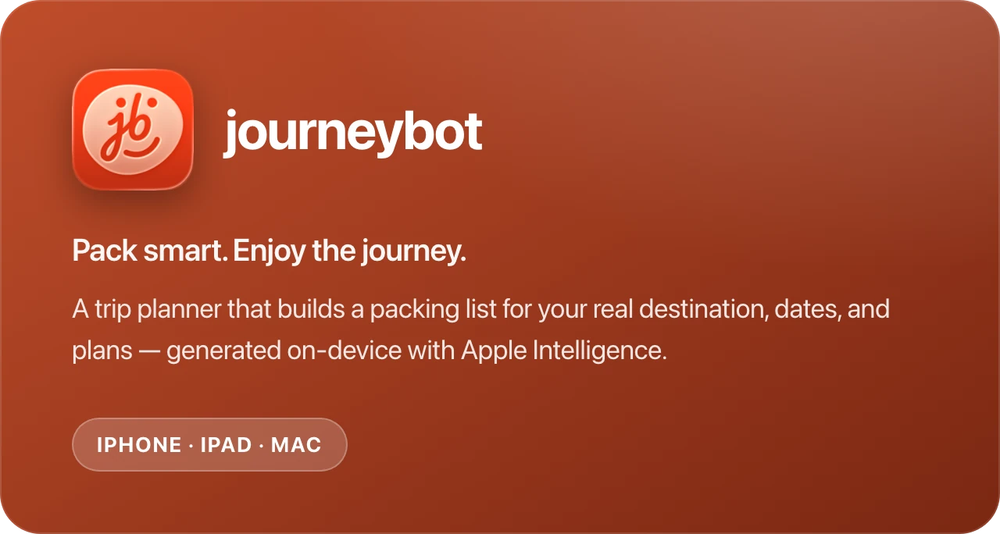
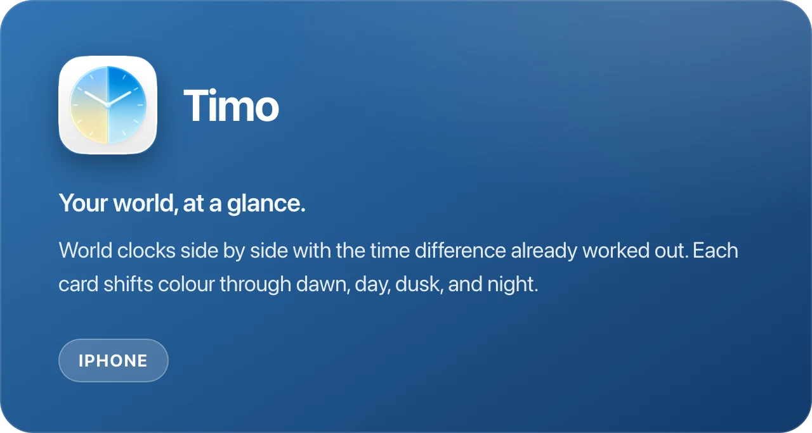
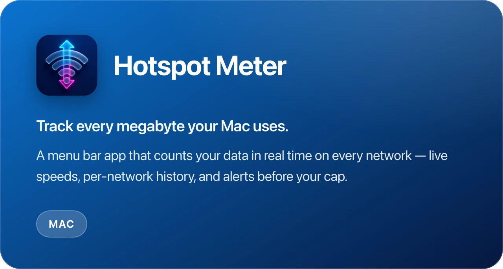

### Hi, I'm Michal 👋

I build small, native Apple apps under the name **[loam](https://www.loam.sk)**, from Bratislava, Slovakia. 
By day I work on product at [Martinus](https://github.com/martinusdev).

Everything below is written in Swift and SwiftUI, ships free, and collects nothing about you.

---

## Apps

  
   
  <a href="https://apps.apple.com/app/apple-store/id6756543673">App&nbsp;Store</a> &nbsp;·&nbsp; <a href="https://journeybot.app">Website</a> &nbsp;·&nbsp; <a href="https://github.com/mferak/journeybot-app/issues">Feedback</a>

  
   
  <a href="https://apps.apple.com/app/apple-store/id6762064286">App&nbsp;Store</a> &nbsp;·&nbsp; <a href="https://trytimo.com">Website</a> &nbsp;·&nbsp; <a href="https://github.com/mferak/timo-app/issues">Feedback</a>

  
   
  <a href="https://apps.apple.com/app/id6763610446">App&nbsp;Store</a> &nbsp;·&nbsp; <a href="https://hotspot-meter.loam.sk">Website</a> &nbsp;·&nbsp; <a href="https://github.com/mferak/hotspot-meter-app/issues">Feedback</a>

  
   
  <a href="https://apps.apple.com/app/apple-store/id6742792242">App&nbsp;Store</a> &nbsp;·&nbsp; <a href="https://kahudo.app">Website</a> &nbsp;·&nbsp; <a href="https://github.com/mferak/kahudo-app/issues">Feedback</a>

> The four repos above host app info and issue trackers, not source code. Bug reports and feature ideas are genuinely welcome — that's what they're for.

## How I build

**Swift · SwiftUI** across iPhone, iPad, and Mac — one codebase, native on each.
**WidgetKit · App Intents · Control Center** for the things you want without opening an app.
**Apple Intelligence Foundation Models** running on-device, so suggestions never leave the phone.
**CloudKit** for sync with no account to create, and **StoreKit 2** where there's something to buy.
**Cloudflare Pages** for the marketing sites — static, no build step, no trackers.

## Elsewhere

[loam.sk](https://www.loam.sk) &nbsp;·&nbsp; [hello@loam.sk](mailto:hello@loam.sk)
